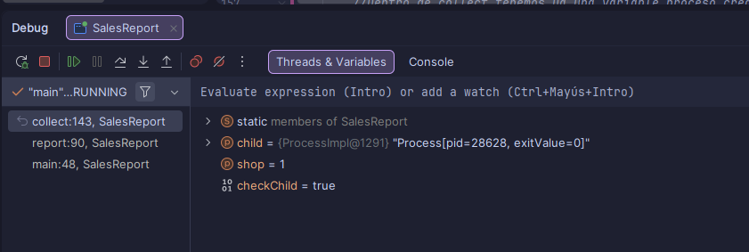

# Informe de ventas en paralelo

Programa que calcula las ventas de una cadena de 8 tiendas. El padre (`SalesReport`) lanza un
proceso hijo (`ShopSummary`) por cada tienda, recoge lo que ha calculado cada uno y saca el
total. Si alguna tienda falla o tarda demasiado, lo avisa y sigue con las demás.

También tiene una caja en directo (`LiveCashRegister`): una caja registradora que saca tickets y
un registro que los va sumando, conectados por una tubería.

## Grupo

| Nombre | Qué ha hecho |
|---|---|
| Gabriel Valencia Bañares | |
| Iván Martos Vivas | |
| Juan Alberto | |

## Cómo se ejecuta

Usamos Java 25 (Temurin 25.0.4.1).

**Desde IntelliJ IDEA:** se abre `SalesReport` o `LiveCashRegister` y se le da a ejecutar. No hace
falta lanzar los hijos (`ShopSummary`, `CashRegister` y `Ledger`) a mano, ya los lanza el padre.

**Desde la terminal**, dentro de la carpeta del proyecto:

```
javac *.java
java SalesReport
java LiveCashRegister
```

`javac` compila todas las clases, y luego se lanza el padre que queramos.

## Procesos

| Clase | Papel | Entrada | Salida | Códigos de salida |
|---|---|---|---|---|
| `SalesReport` | Padre. Lanza un hijo por tienda, lee lo que calcula cada uno, lo suma y escribe el informe | Nada | Salida estándar: una línea por tienda (PID, unidades y euros), el total, cuántas tiendas han fallado y el tiempo | — |
| `ShopSummary` | Hijo. Calcula las ventas de una tienda | El número de la tienda, por argumento (del 1 al 8) | Salida estándar: una línea `unidades;céntimos`. Salida de error: el mensaje si algo va mal | 0: todo bien. 1: la tienda no existe o el argumento está mal |
| `LiveCashRegister` | Padre. Lanza la caja y el registro unidos por una tubería, en dos escenarios, y espera a los dos | Nada | Salida estándar: qué escenario empieza. Las trazas y el total de los hijos salen también en su consola | — |
| `CashRegister` | Hijo (productor). La caja: saca tickets | Por argumento: cuántos tickets y la pausa antes de cada uno (ms) | Salida estándar (va a la tubería): un ticket por línea, `número;céntimos`. Salida de error: la hora de cada ticket | 0: todo bien |
| `Ledger` | Hijo (consumidor). El registro: lee los tickets y los suma | Por argumento: la pausa después de cada ticket (ms). Entrada estándar (viene de la tubería): los tickets | Salida estándar: cuántos tickets y el total en euros. Salida de error: la hora a la que lee cada ticket | 0: todo bien |

**Informe de ventas:** el padre lanza cada hijo con `ProcessBuilder`, usando la misma versión de
Java y el mismo classpath que él, y le pasa el número de tienda como argumento. La salida normal
del hijo va por una tubería hasta el padre, que la lee con `inputReader()`, la parte por el `;` y
la suma a los totales. La salida de error del hijo no pasa por el padre: se hereda
(`redirectError(INHERIT)`), así que sus mensajes salen directamente en nuestra consola.

Antes de leer nada, el padre espera a cada hijo como mucho `TIMEOUT` segundos. Si no ha
terminado, lo mata (`destroy()`). Si ha terminado pero con un código distinto de 0, no lee su
resultado. En los dos casos avisa de qué tienda ha fallado y la cuenta en `failedShops`.

El informe se hace de dos formas:
- **Uno a uno**: lanza una tienda, espera a que acabe y la recoge, y luego pasa a la siguiente.
- **Todos a la vez**: primero lanza las 8 tiendas y las guarda en un array, y después las va
  recogiendo una por una. Así las 8 trabajan al mismo tiempo.

**Caja en directo:** el padre crea un `ProcessBuilder` para la caja y otro para el registro, y los
lanza juntos con `ProcessBuilder.startPipeline()`. Así, lo que la caja escribe por su salida
normal le entra directamente al registro por su entrada. Las trazas de los dos (salida de error)
y el total del registro (su salida normal) se heredan, para que se vean en la consola del padre.
Al final, el padre espera a los dos con `waitFor()`.

## Pruebas realizadas

| Prueba | Resultado esperado | Resultado obtenido |
|---|---|---|
| Informe de las 8 tiendas (uno a uno y todos a la vez) | Total del enunciado: 1.200.014.349 unidades y 3.381.671.938,70 € | Sale exactamente eso en los dos modos, y cada tienda coincide con la tabla del enunciado |
| Una tienda que no existe (`SHOPS = 9`) | Las tiendas 1-8 bien, la 9 falla con código 1 y no salta ninguna excepción | El hijo escribe "No existe la tienda 9: hay de la 1 a la 8", el padre dice que la tienda 9 ha fallado con código 1, el total sigue siendo el correcto y "tiendas que han fallado: 1" |
| Tiempo límite a 0 (`TIMEOUT = 0`) | Ningún hijo termina a tiempo, todos se cortan y no salta ninguna excepción | Las 8 tiendas salen como "no ha respondido a tiempo", el total es 0 unidades y 0,00 €, y "tiendas que han fallado: 8" |
| Caja en directo, escenario 1 (5 tickets, caja 500 ms, registro 0) | El registro lee cada ticket nada más salir | Cada ticket se lee en el mismo milisegundo (o 1 ms después) en que la caja lo saca. Total: 5 tickets |
| Caja en directo, escenario 2 (10 tickets, caja 0, registro 300 ms) | La caja saca todo de golpe y el registro va leyendo poco a poco | La caja saca los 10 en unos 4 ms. El registro tarda casi 3 segundos en leerlos. Total: 10 tickets |

## Tiempos

Lo hemos probado en un ordenador con [X] núcleos:

| Modo | Tiempo |
|---|---|
| Uno a uno | 3.359 ms |
| Todos a la vez | 471 ms |

Todos a la vez va unas **7,13 veces más rápido**.

¿Por qué no va 8 veces más rápido si hay 8 tiendas? Porque no todo se puede hacer en paralelo:
- Arrancar cada hijo cuesta un poco, porque hay que abrir una Java nueva para cada uno, y eso
  no se acelera.
- El padre sigue recogiendo los resultados uno detrás de otro.
- Si el ordenador tiene menos de 8 núcleos, no puede tener las 8 tiendas trabajando de verdad a
  la vez, y algunas tienen que esperar su turno.

## Caja en directo

### Escenario 1: caja lenta, registro rápido (5 tickets, caja 500 ms, registro 0)

```
01:00:12.242 caja: ticket 1
01:00:12.243 registro: ticket 1
01:00:12.747 caja: ticket 2
01:00:12.747 registro: ticket 2
01:00:13.247 caja: ticket 3
01:00:13.247 registro: ticket 3
01:00:13.747 caja: ticket 4
01:00:13.747 registro: ticket 4
01:00:14.248 caja: ticket 5
01:00:14.248 registro: ticket 5
01:00:14.248 caja: fin
Registro: 5 tickets, total 156,81 euros
```

**Quién espera: el registro.** La caja saca un ticket cada medio segundo, y el registro lo lee
en el mismo milisegundo. Eso quiere decir que el registro ya estaba listo y **esperando** a que
llegara algo por la tubería. Cuando intenta leer y la tubería está vacía, se queda parado hasta
que la caja escribe el siguiente ticket.

### Escenario 2: caja rápida, registro lento (10 tickets, caja 0, registro 300 ms)

```
01:00:14.347 caja: ticket 1
01:00:14.350 caja: ticket 2
01:00:14.350 caja: ticket 3
01:00:14.351 caja: ticket 4
01:00:14.351 caja: ticket 5
01:00:14.351 caja: ticket 6
01:00:14.351 caja: ticket 7
01:00:14.351 caja: ticket 8
01:00:14.351 caja: ticket 9
01:00:14.351 caja: ticket 10
01:00:14.351 caja: fin
01:00:14.349 registro: ticket 1
01:00:14.656 registro: ticket 2
01:00:14.957 registro: ticket 3
01:00:15.258 registro: ticket 4
01:00:15.559 registro: ticket 5
01:00:15.860 registro: ticket 6
01:00:16.161 registro: ticket 7
01:00:16.462 registro: ticket 8
01:00:16.763 registro: ticket 9
01:00:17.063 registro: ticket 10
Registro: 10 tickets, total 312,34 euros
```

**Quién espera: los tickets, dentro de la tubería.** La caja saca los 10 tickets de golpe, en
unos 4 ms, y termina. El registro tarda 300 ms con cada uno, así que los tickets se quedan
**guardados en la tubería** esperando a que el registro los lea. La caja no espera a nadie: la
tubería tiene sitio de sobra para 10 tickets.

Un detalle: "registro: ticket 1" sale después de "caja: fin", aunque su hora (14.349) es anterior.
Pasa porque los dos procesos escriben en la misma consola a la vez y las líneas se mezclan. Lo
que vale es la hora, no el orden en que aparecen.

## Depuración



Pusimos un punto de ruptura en `collect`, en la línea justo después de
`child.waitFor(TIMEOUT, TimeUnit.SECONDS)`, y ejecutamos `SalesReport` en modo depuración.

En la vista Variables comprobamos que:
- `shop = 1`: es el hijo de la tienda 1.
- `checkChild = true`: el hijo terminó antes del tiempo límite.
- `child` = `Process[pid=28628, exitValue=0]`: el hijo ha terminado con **código de salida 0**,
  o sea, todo ha ido bien. Por eso el padre sigue y lee su resultado, en lugar de meterse en
  los `if` de error.

A la izquierda se ve también el camino que ha seguido el programa hasta ahí:
`main` → `report` → `collect`.